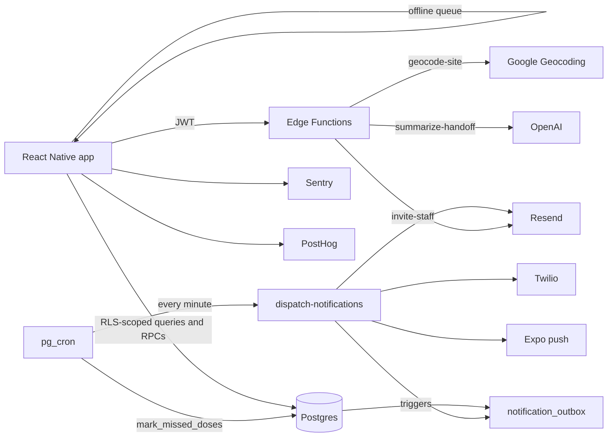

# Care Log: a multi-site care app on React Native and Supabase

[](https://github.com/techsavvysenior/expo-supabase-care-log/actions/workflows/ci.yml)

A React Native (Expo) and Supabase sample for residential care providers: staff write care notes and record medication doses, even with no signal, and managers see an audit trail. Many providers share one Supabase project, and Postgres keeps each one's records apart.

It is built the way a lead developer would hand it to a team: use cases with ids, tests at three levels tagged with those ids, a CI check that every use case is covered, decision records, a security model and a pull request checklist.

## What it shows

**Tenant and site isolation in Postgres.** Row-level security on every table, scoped by organization and, for caregivers, by the houses they are assigned to. Composite foreign keys stop a row being attached to another provider's site or resident even by code that bypasses RLS. [ADR 1](docs/adr/0001-tenant-isolation-in-postgres.md)

**Append-only clinical records.** Notes, dose records and the audit trail can't be updated or deleted by anyone, including the service role. Mistakes are fixed with a correction that points at the original. [ADR 2](docs/adr/0002-append-only-clinical-records.md)

**A medication record with real rules.** `record_dose()` checks the order is active that day in the site's time zone, the time is on the order, the dose isn't more than an hour early, refusals have a reason and nobody records the same dose twice. A pg_cron job marks doses missed after an hour and alerts the nurses.

**Audit trail.** Every chart opened, note written, dose recorded and AI request made, readable by admins and auditors.

**Offline writes without duplicates.** Each write carries a `client_ref` set when Save was pressed, so a retry after a timeout returns the existing record. The queue lives in the Keychain/Keystore and flushes when the connection returns. [ADR 5](docs/adr/0005-offline-writes-with-client-refs.md)

**Third-party integrations, each behind a tested client:**

| Service | Used for | Health information sent |
|---|---|---|
| Expo push | Incident, handoff and missed-dose alerts | None. Generic text and a deep link |
| Resend | Email alerts and staff invitations | None in alerts |
| Twilio | SMS for missed doses (opt-in) | None |
| OpenAI (Responses API) | Shift handoff drafts | Pseudonymized notes, only with a BAA on record; `store: false` |
| Google Geocoding | Site map pins | None. Facility addresses only |
| Sentry | Crash reports | None. Scrubbed on the device |
| PostHog | Analytics and the AI feature flag | None. Allow-listed events only |

Notifications go through an outbox whose payload a CHECK constraint limits to identifiers. [ADR 3](docs/adr/0003-phi-free-notifications-outbox.md) AI drafts are reviewed and posted by a person, per resident. [ADR 4](docs/adr/0004-ai-drafts-with-a-human-in-the-loop.md)

## Quality

| | Count | Command |
|---|---:|---|
| Database tests (real Postgres via PGlite, per role) | 74 | `npm run test:db` |
| Edge Function handler tests (Deno) | 19 | `npm run test:functions` |
| Unit tests (Jest), 90% line coverage gate on `src/core` | 65 | `npm test` |
| Use cases, each with at least one tagged test | 17 | `npm run check:traceability` |
| End-to-end flows (Maestro, run before release) | 3 | `maestro test .maestro/` |

- [Use cases](docs/use-cases.md) and the generated [traceability matrix](docs/traceability.md)
- [Test plan](docs/test-plan.md): what is tested at which level, risk priorities, release criteria, what isn't automated
- [Security notes](docs/security.md): HIPAA technical safeguards mapped to code, what each vendor receives, threats and known gaps
- [Contributing](CONTRIBUTING.md): definition of done, database rules, review checklist

## Architecture



```
src/
  core/              Plain TypeScript shared with the Edge Functions
    integrations/      Expo push, Resend, Twilio, OpenAI, Google clients; retries and timeouts
    notifications/     PHI-free templates and the multi-channel dispatcher
    handoff/           Pseudonymize notes for the AI and map labels back
    privacy/           Sentry event and breadcrumb scrubbing
    analytics/         Allow-listed PostHog events
    offline/           Ordered, idempotent offline write queue
    mar/               Dose window rules for the medication screen
    roles.ts, errors.ts
  platform/          Sentry, PostHog, push registration, secure queue storage
  features/          Session and organization switching, site selection, queries
  app/               Screens: residents, resident chart, medications, handoff, admin
supabase/
  migrations/        Tenancy, care records, notifications
  functions/         dispatch-notifications, summarize-handoff, geocode-site, invite-staff (+ tests/)
  tests/             Database tests
  schedules.sql      pg_cron jobs for a hosted project
docs/                Use cases, traceability, test plan, security, ADRs
.maestro/            End-to-end flows
```

## Run it

Requires Node 22.18 or later, the Supabase CLI and Deno 2. Push notifications, maps and secure storage need a development build, not Expo Go.

```bash
npm install
cp .env.example .env
cp supabase/functions/.env.example supabase/functions/.env

supabase link --project-ref <your-ref>
supabase db push
supabase secrets set --env-file supabase/functions/.env
supabase functions deploy --use-api
```

`--use-api` lets the CLI bundle the shared files in `src/core` that the functions import. Then run `supabase/schedules.sql` in the SQL editor to start the missed-dose job and the dispatcher, and create a PostHog flag named `ai-handoff-drafts` if you want the handoff screen.

```bash
npx expo run:ios       # or run:android
```

Sign up and create your organization on the first screen (you become its admin). Add a site with an insert into `sites` (admins are allowed by RLS), then invite staff from the Admin tab.

## Checks

```bash
npm run check              # types, lint, unit tests, database tests, traceability
npm run test:functions     # Edge Function handler tests (Deno)
npm run check:functions    # Deno type check of the function entry points
```

## Limits

This is a sample, not a certified product.

- It has not been run against live Expo, Resend, Twilio, OpenAI or Google accounts, or on a physical device from this repository's CI. The clients are tested against the documented request and response shapes with a fake fetch.
- Compliance needs more than code: signed BAAs (Supabase HIPAA add-on, OpenAI), policies and training. See [docs/security.md](docs/security.md) for the gaps (no MFA enforcement, no break-glass flow, no retention tooling).
- There is no UI yet for admitting residents or entering medication orders; they go in through the database functions and policies that the tests cover.
- Medication orders are fixed daily times. PRN (as-needed) doses, tapering and weekly schedules are not modelled.

## Versions

Expo SDK 58, React Native 0.88, TypeScript 6, Supabase JS 2, `@sentry/react-native` 8.28, `posthog-react-native` 4.87, `react-native-maps` 1.29, Deno 2 for Edge Functions. API shapes checked November 2026.

## License

MIT
